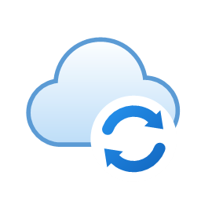
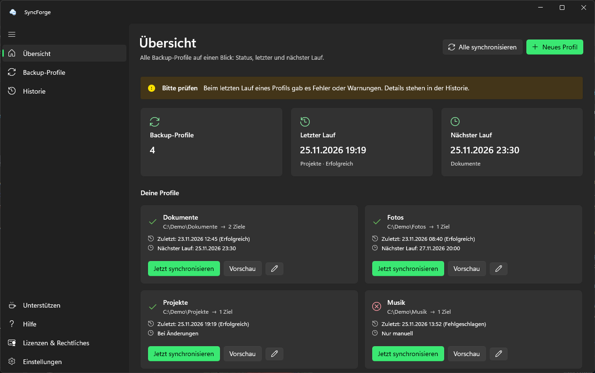
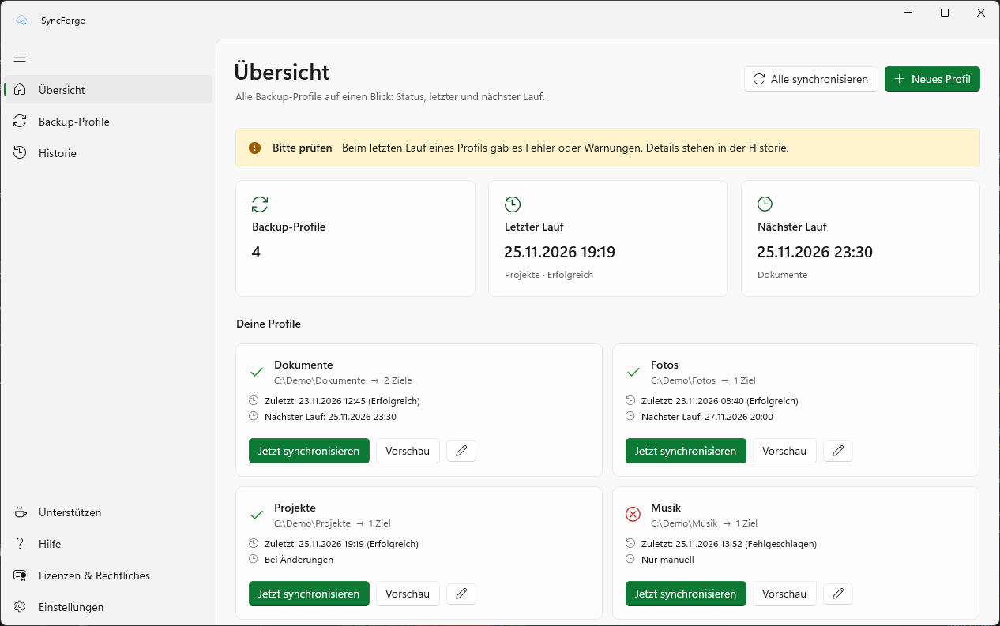
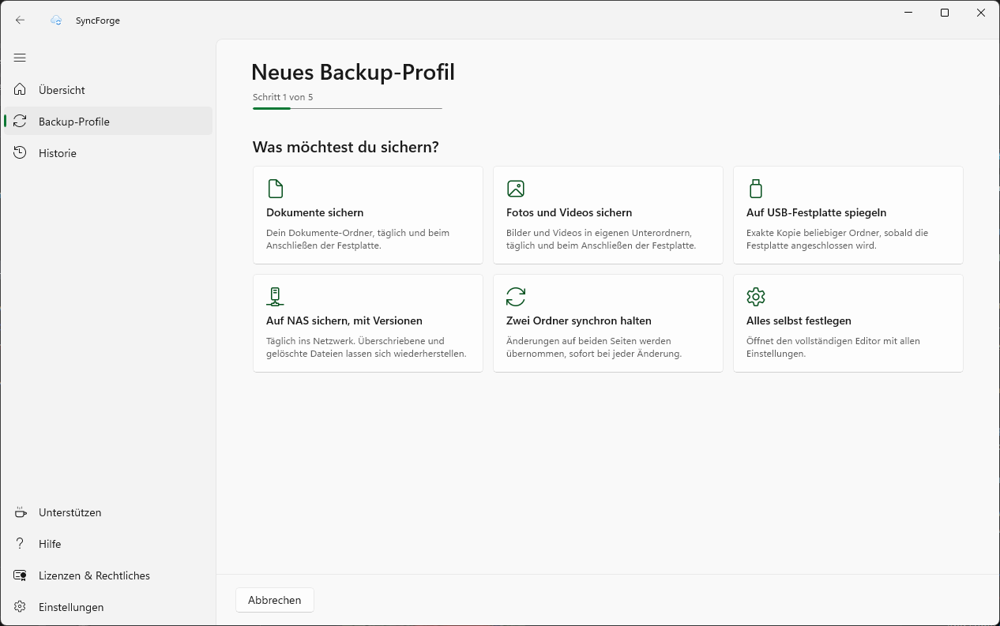
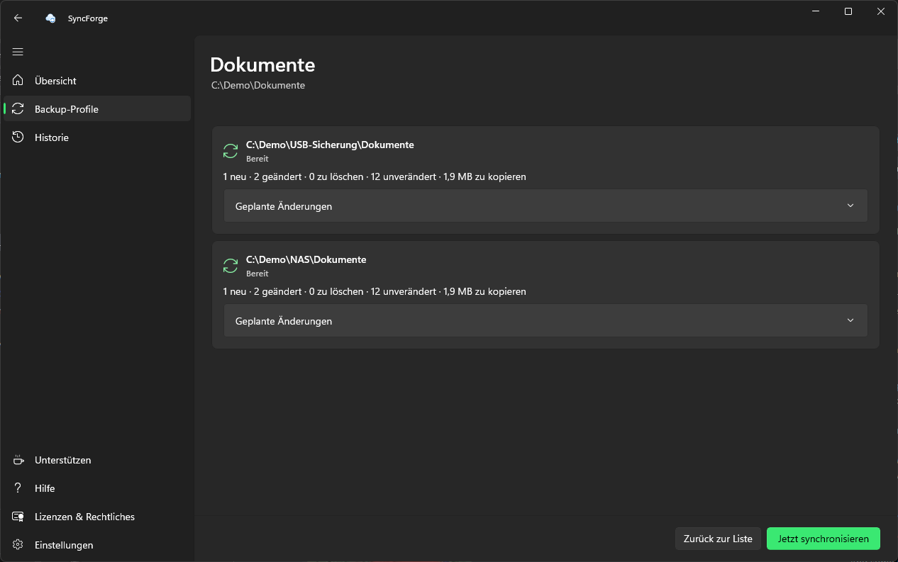
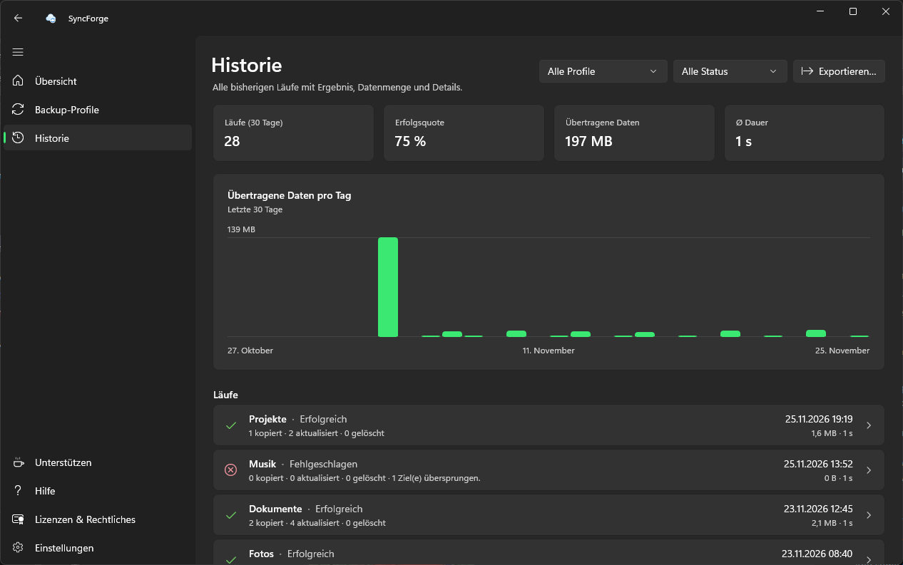
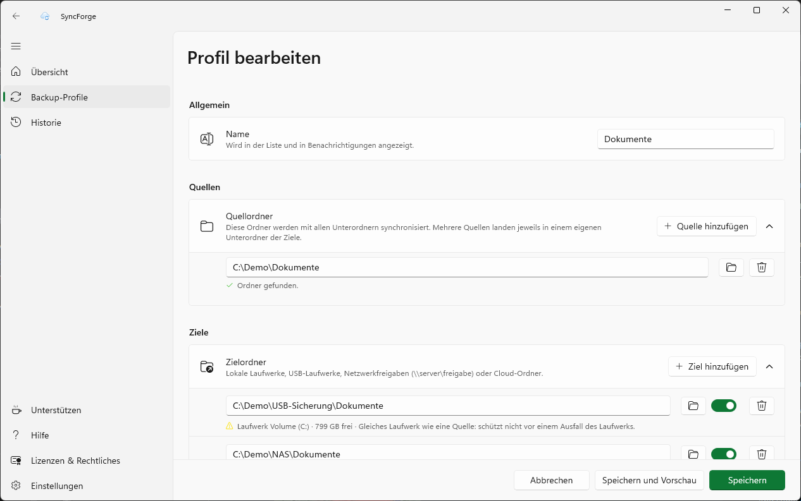

<p align="center">
  
</p>

<h1 align="center">SyncForge</h1>

<p align="center">
  Ordner sichern und synchronisieren unter Windows 11: auf USB-Festplatten, Netzwerkfreigaben und Cloud-Ordner.<br>
  <a href="README.md">English</a> · <b>Deutsch</b>
</p>

<p align="center">
  <a href="https://github.com/RNYSVRN/SyncForge/releases/latest"></a>
  
  <a href="LICENSE"></a>
</p>

<p align="center">
  
  
</p>

Backups helfen nur, wenn sie auch wirklich laufen. **SyncForge** kopiert deine Ordner auf ein oder mehrere Ziele: nach Zeitplan, bei Änderungen oder sobald die USB-Festplatte angesteckt wird. Vor jedem Lauf siehst du genau, was kopiert, geändert und gelöscht wird, und nichts wird still überschrieben. Spiegeln, versioniert sichern oder in beide Richtungen abgleichen, alles in einer nativen Windows-11-App.

## Download

**[⬇ Neuestes Installationsprogramm herunterladen](https://github.com/RNYSVRN/SyncForge/releases/latest)** (`SyncForge-Setup-x.y.z.exe`)

Keine .NET-Installation nötig, alles ist enthalten. Voraussetzung: Windows 11, 64 Bit. Standardmäßig wird nur für dein Benutzerkonto installiert (ohne Admin-Abfrage), wahlweise für alle Benutzer.

> [!NOTE]
> **Windows warnt eventuell beim ersten Start.** SyncForge ist kostenlos und deshalb **nicht signiert** (eine Signatur kostet jeden Monat Geld).
> - *„Der Computer wurde durch Windows geschützt“* (SmartScreen): auf **Weitere Informationen** → **Trotzdem ausführen** klicken.
> - *„Eine Richtlinie zur Anwendungssteuerung hat diese Datei blockiert“* (intelligente App-Steuerung): Sie lässt nur signierte Apps zu. SyncForge läuft dann nur, wenn sie ausgeschaltet ist (*Windows-Sicherheit → App- & Browsersteuerung*). Achtung: Einmal ausgeschaltet, lässt sie sich nur durch Zurücksetzen von Windows wieder einschalten. Entscheide selbst.
>
> Der komplette Quellcode liegt in diesem Repository, du kannst ihn prüfen oder selbst bauen.

## Funktionen

- **In einer Minute eingerichtet**
  - Assistent mit Vorlagen: Dokumente sichern, Fotos und Videos sichern, auf USB-Festplatte spiegeln, NAS mit Versionen, zwei Ordner synchron halten
  - Profile mit mehreren Quellen und mehreren Zielen, nacheinander oder gleichzeitig
- **Drei Modi**
  - *Spiegeln*: Das Ziel ist eine exakte Kopie der Quelle (Löschungen wahlweise in den Papierkorb)
  - *Versioniert*: wie Spiegeln, überschriebene und gelöschte Dateien bleiben aber erhalten und lassen sich wiederherstellen
  - *Zwei-Wege*: Änderungen und Löschungen in beide Richtungen; Konflikte per Regel (neuere gewinnt, Quelle gewinnt, beide behalten) oder pro Datei entschieden
- **Läuft von selbst**: Zeitpläne (Intervall, täglich, an bestimmten Wochentagen) mit Nachholen verpasster Läufe, Echtzeit-Überwachung, beim Start und sobald das Ziellaufwerk verbunden ist, auch unter anderem Laufwerksbuchstaben
- **Sicher**
  - Vorschau vor jedem Lauf, pro Ziel
  - Löschschutz, Papierkorb, optionale Prüfsummen-Kontrolle, nie halb kopierte Dateien (Temp-Datei, dann ersetzen)
  - Gesperrte Dateien (z. B. eine geöffnete Outlook-PST) werden über eine Schattenkopie gelesen
- **Rücksichtsvoll**: niedrige E/A-Priorität und Bandbreitenlimit, Pause im Akkubetrieb und bei getakteten Verbindungen; reine Online-Dateien (OneDrive & Co.) werden übersprungen statt heruntergeladen
- **Netzwerkfreigaben** mit gespeicherten Anmeldedaten
- **Nachvollziehbar**: Historie mit Statistik, Diagramm der letzten 30 Tage und Details zu jeder Datei; CSV-Export für Excel
- **Infobereich**, Benachrichtigungen und Start mit Windows
- **Befehlszeile** für Skripte und die Aufgabenplanung
- **Windows-11-Fluent-Design**: helles/dunkles Design, deine Akzentfarbe, Mica, einklappbare Navigation; vollständig per Tastatur und Sprachausgabe bedienbar
- **Deutsch und Englisch**, mit eingebauter Hilfe
- **Privat**: keine Telemetrie, keine Werbung, kein Konto

<p align="center">
  
  
</p>
<p align="center">
  
  
</p>

## Befehlszeile

```
SyncForge --run "Dokumente"     Profil synchronisieren (Name oder ID, mehrfach möglich)
SyncForge --run-all             alle Profile synchronisieren
SyncForge --list                Profile mit ihrer ID auflisten
SyncForge --help
```

Läuft SyncForge schon, übernimmt das offene Fenster den Lauf. Exitcodes: 0 Erfolg, 1 Warnung, 2 Fehler, 3 abgebrochen, 4 Profil nicht gefunden, 5 ungültige Argumente, 6 läuft bereits.

## Gut zu wissen

- **Wo die Daten liegen**: In `%LocalAppData%\SyncForge` stehen Einstellungen, Profile (`profiles.json`), Historie (`history.db`) und der Stand der Zwei-Wege-Profile. Frühere Fassungen von Dateien liegen im Ziel unter `.syncforge_versions`.
- **Deinstallieren** entfernt den Autostart-Eintrag und die Benachrichtigungs-Registrierung und fragt, ob auch Einstellungen, Profile und Historie gelöscht werden sollen. Deine gesicherten Dateien in den Zielen bleiben immer erhalten.
- **Updates**: Die optionale Update-Prüfung (standardmäßig aus) fragt einmal täglich bei GitHub nach einer neuen Version. Installiert wird nichts automatisch: neues Setup ausführen, Profile und Einstellungen bleiben erhalten.
- **Gesperrte Dateien** per Schattenkopie brauchen SyncForge als Administrator, alles andere läuft ohne.

## Selbst bauen

Voraussetzungen: [.NET 10 SDK](https://dotnet.microsoft.com/download), optional [Inno Setup 6](https://jrsoftware.org/isdl.php) für das Installationsprogramm.

```powershell
dotnet build SyncForge.sln -c Debug -p:Platform=x64                            # App
dotnet test --project tests\SyncForge.Core.Tests\SyncForge.Core.Tests.csproj   # Tests
powershell -ExecutionPolicy Bypass -File installer\build.ps1                   # eigenständiger Build + Setup in dist\
```

Alle Texte der Oberfläche stehen in `tools/strings.csv` (Deutsch und Englisch); `tools/Generate-Strings.ps1` erzeugt daraus die `.resw`-Dateien. Die Hilfethemen sind Markdown-Dateien in `src/SyncForge/Assets/Help`.

## Unterstützen

SyncForge ist kostenlos und bleibt es. Wenn dir die App Zeit und Nerven spart, freue ich mich über einen Kaffee:

<a href="https://ko-fi.com/RNYSVRN"></a>

Ideen und Fehlermeldungen gerne als [Issue](https://github.com/RNYSVRN/SyncForge/issues).

## Danksagung

Gebaut mit dem [Windows App SDK](https://github.com/microsoft/WindowsAppSDK) (WinUI 3), dem [Windows Community Toolkit](https://github.com/CommunityToolkit/Windows), dem [.NET Community Toolkit](https://github.com/CommunityToolkit/dotnet) und [SQLite](https://sqlite.org) über Microsoft.Data.Sqlite. Die Lizenztexte sind in der App enthalten (*Lizenzen & Rechtliches*).

## Lizenz

[MIT](LICENSE) © 2026 Ronny Severin.
