<div align="center">


# SyncForge

**Ordner synchronisieren und sichern unter Windows 11. Kostenlos, Open Source, ohne Konto.**

[](https://github.com/RNYSVRN/SyncForge/releases/latest)
[](https://github.com/RNYSVRN/SyncForge/actions/workflows/build.yml)
[](LICENSE)


[Download](https://github.com/RNYSVRN/SyncForge/releases/latest) · [Funktionen](#funktionen) · [Screenshots](#screenshots) · [Befehlszeile](#befehlszeile) · [Unterstützen](#unterstützen)

[English](README.md) · **Deutsch**

</div>

<picture>
  <source media="(prefers-color-scheme: dark)" srcset="docs/screenshots/dark/01-overview.png">
  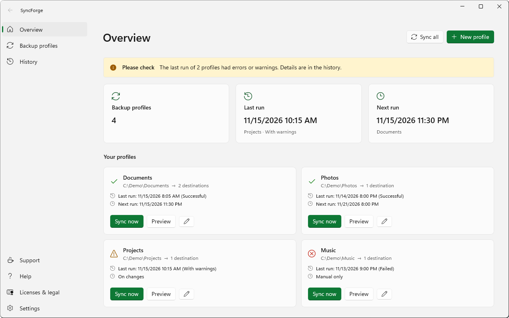
</picture>

SyncForge sichert deine Ordner auf lokale Laufwerke, USB-Festplatten, Netzwerkfreigaben (NAS) und in Cloud-Ordner.
Eine native WinUI-3-App mit .NET 10: schnell, schlank und zu Hause in Windows 11, im hellen und dunklen Design,
auf Deutsch und Englisch.

## Funktionen

**In einer Minute eingerichtet**
- Assistent mit Vorlagen: Dokumente sichern, Fotos und Videos sichern, auf USB-Festplatte spiegeln, NAS mit Versionen, zwei Ordner synchron halten
- Backup-Profile mit mehreren Quellen und mehreren Zielen, nacheinander oder gleichzeitig
- Drei Modi: **Spiegeln**, **Versioniert** (überschriebene und gelöschte Dateien wiederherstellbar) und **Zwei-Wege** mit Konfliktregeln

**Läuft von allein**
- Zeitpläne (Intervall, täglich, an gewählten Wochentagen) und Nachholen verpasster Läufe
- Echtzeit-Überwachung, beim Start von SyncForge und sobald das Ziel-Laufwerk angeschlossen wird (auch unter anderem Laufwerksbuchstaben)
- Befehlszeile für Skripte und die Aufgabenplanung, mit aussagekräftigen Exitcodes

**Sicher von Grund auf**
- Vorschau vor jedem Lauf: genau sehen, was kopiert, geändert und gelöscht wird
- Löschschutz, Papierkorb, optionale Prüfsummen, nie halb kopierte Dateien (Temp-Datei, dann Ersetzen)
- Zwei-Wege-Konflikte werden pro Datei entschieden, nie stillschweigend überschrieben
- Gesperrte Dateien (z. B. eine geöffnete Outlook-PST) lassen sich über eine Schattenkopie lesen

**Rücksichtsvoll**
- Niedrige E/A-Priorität und Bandbreitenlimit, global oder pro Profil
- Pausiert im Akkubetrieb und bei getakteten Verbindungen
- Nur online verfügbare Cloud-Dateien (OneDrive und Co.) werden übersprungen statt heruntergeladen

**Nachvollziehbar**
- Historie mit Statistik, Diagramm der letzten 30 Tage und Details zu jeder einzelnen Datei
- Läufe und Dateilisten als CSV exportieren, direkt für Excel
- Benachrichtigungen, Symbol im Infobereich, Autostart

**Zu Hause in Windows**
- Fluent Design mit Mica, hell, dunkel und hoher Kontrast
- Vollständig mit Tastatur und Bildschirmleser bedienbar
- Keine Telemetrie, keine Werbung, kein Konto

## Screenshots

Die Screenshots folgen deinem GitHub-Design und zeigen die englische Oberfläche. Beide vollständigen Sätze (hell und
dunkel) stehen in den Galerien am Ende dieses Abschnitts.

### Assistent
Vorlage wählen, vorgeschlagene Ordner prüfen, Ziel auswählen. Fertig.

<picture>
  <source media="(prefers-color-scheme: dark)" srcset="docs/screenshots/dark/04-wizard.png">
  
</picture>

### Vorschau
Bevor etwas passiert, siehst du jede geplante Änderung pro Ziel.

<picture>
  <source media="(prefers-color-scheme: dark)" srcset="docs/screenshots/dark/05-preview.png">
  
</picture>

### Historie
Jeder Lauf mit Statistik, Tagesdiagramm, Filtern und CSV-Export.

<picture>
  <source media="(prefers-color-scheme: dark)" srcset="docs/screenshots/dark/07-history.png">
  
</picture>

### Profil-Editor
Alle Einstellungen eines Profils auf einer Seite, mit sofortigen Hinweisen zu Pfaden und Laufwerken.

<picture>
  <source media="(prefers-color-scheme: dark)" srcset="docs/screenshots/dark/03-editor.png">
  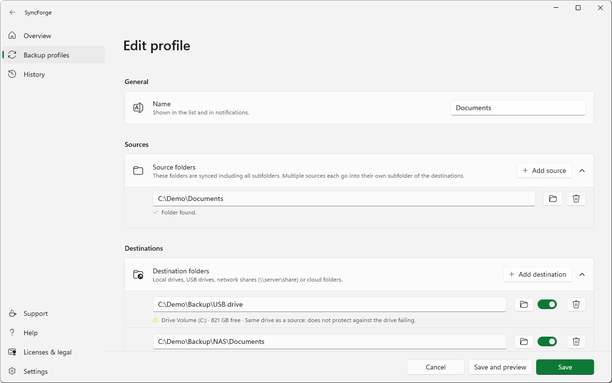
</picture>

<details>
<summary><b>Weitere Seiten</b>: Profile, Versionen, Laufdetails, Konflikte, Einstellungen, Hilfe, Unterstützen, Lizenzen</summary>

#### Backup-Profile
<picture>
  <source media="(prefers-color-scheme: dark)" srcset="docs/screenshots/dark/02-profiles.png">
  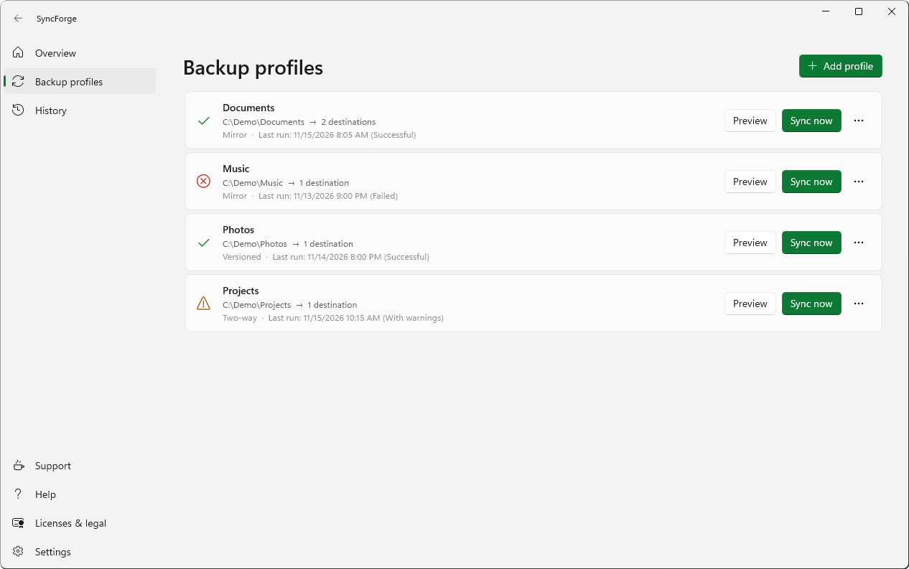
</picture>

#### Versionen wiederherstellen
<picture>
  <source media="(prefers-color-scheme: dark)" srcset="docs/screenshots/dark/06-versions.png">
  
</picture>

#### Laufdetails
<picture>
  <source media="(prefers-color-scheme: dark)" srcset="docs/screenshots/dark/08-run-details.png">
  
</picture>

#### Konflikte lösen
<picture>
  <source media="(prefers-color-scheme: dark)" srcset="docs/screenshots/dark/09-conflicts.png">
  
</picture>

#### Einstellungen
<picture>
  <source media="(prefers-color-scheme: dark)" srcset="docs/screenshots/dark/10-settings.png">
  
</picture>

#### Eingebaute Hilfe
<picture>
  <source media="(prefers-color-scheme: dark)" srcset="docs/screenshots/dark/11-help.png">
  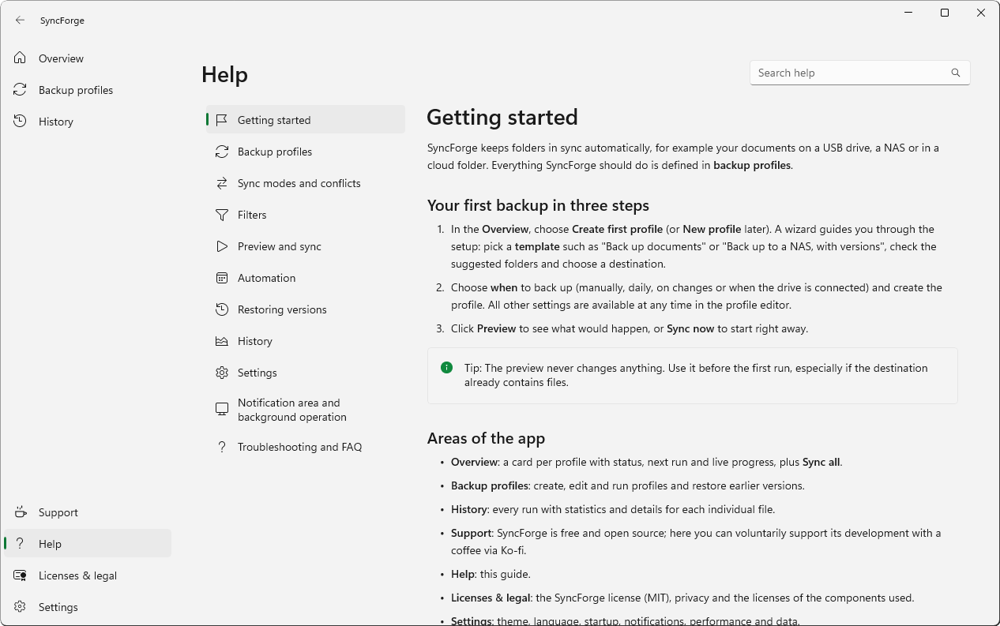
</picture>

#### Unterstützen
<picture>
  <source media="(prefers-color-scheme: dark)" srcset="docs/screenshots/dark/12-support.png">
  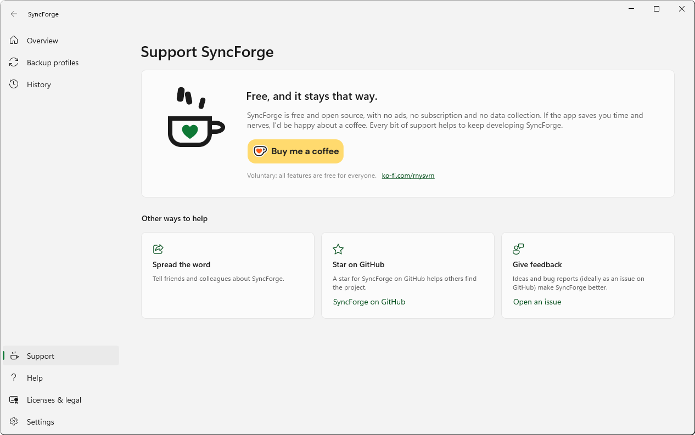
</picture>

#### Lizenzen & Rechtliches
<picture>
  <source media="(prefers-color-scheme: dark)" srcset="docs/screenshots/dark/13-licenses.png">
  
</picture>

</details>

<details>
<summary><b>Galerie: helles Design</b> (alle Seiten)</summary>

| | |
|---|---|
|  |  |
|  |  |
|  |  |
|  |  |
|  |  |
|  |  |
|  | |

</details>

<details>
<summary><b>Galerie: dunkles Design</b> (alle Seiten)</summary>

| | |
|---|---|
| 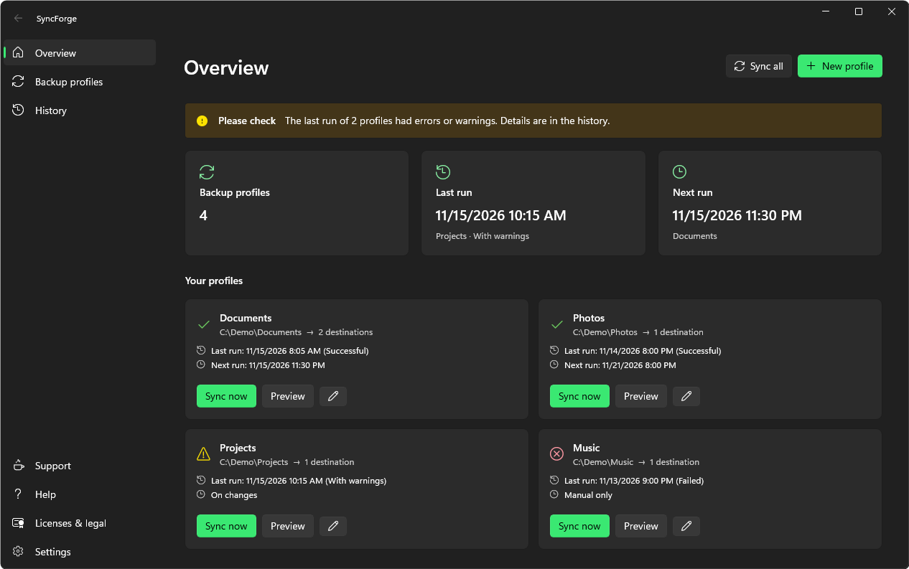 | 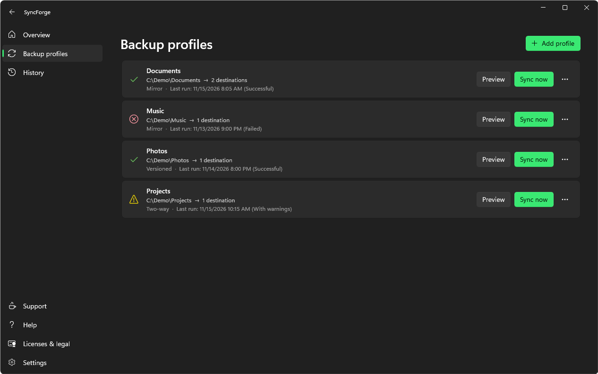 |
| 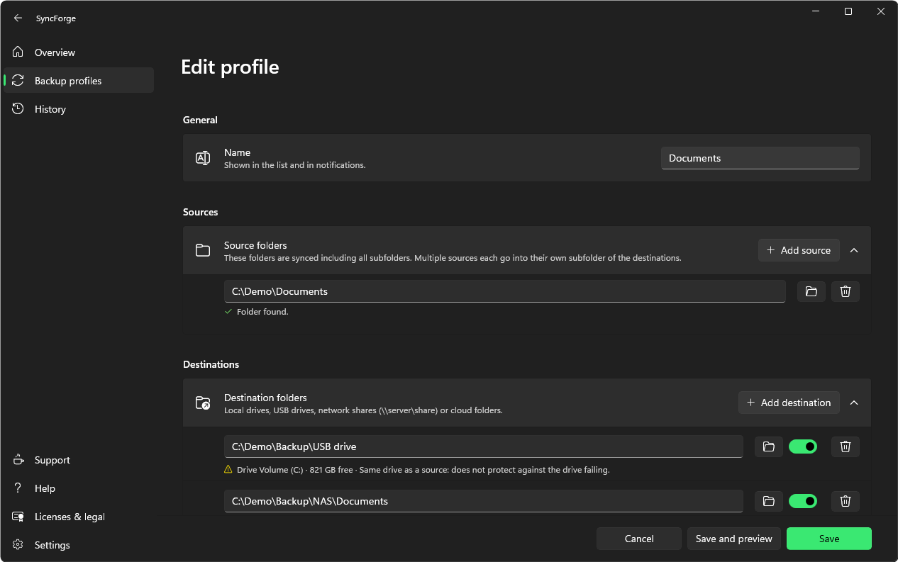 |  |
| 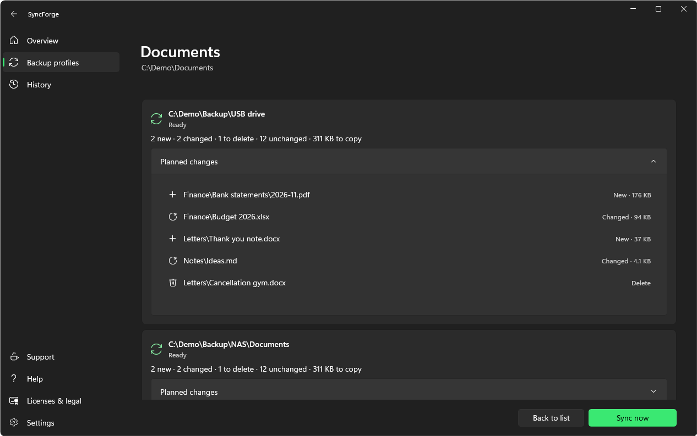 | 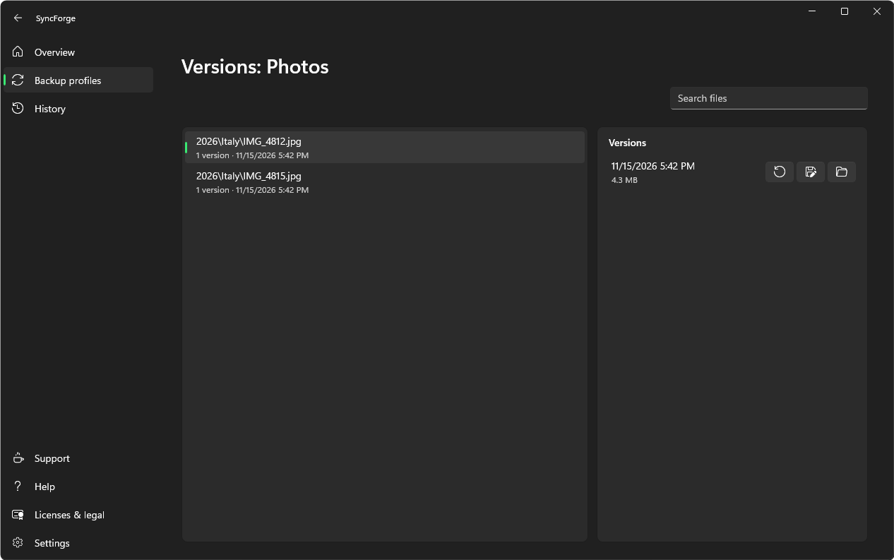 |
|  | 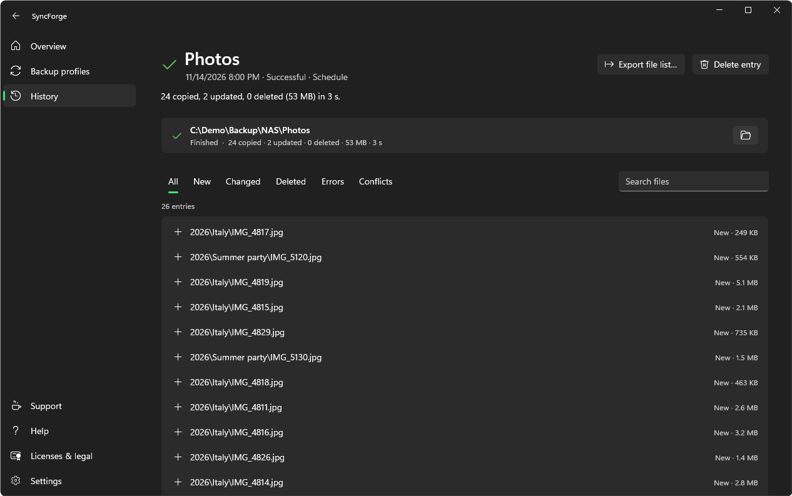 |
|  |  |
| 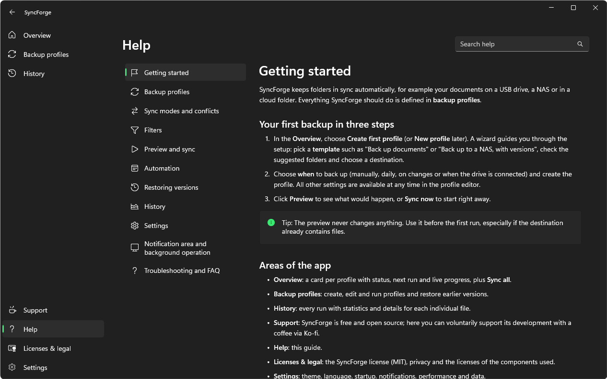 | 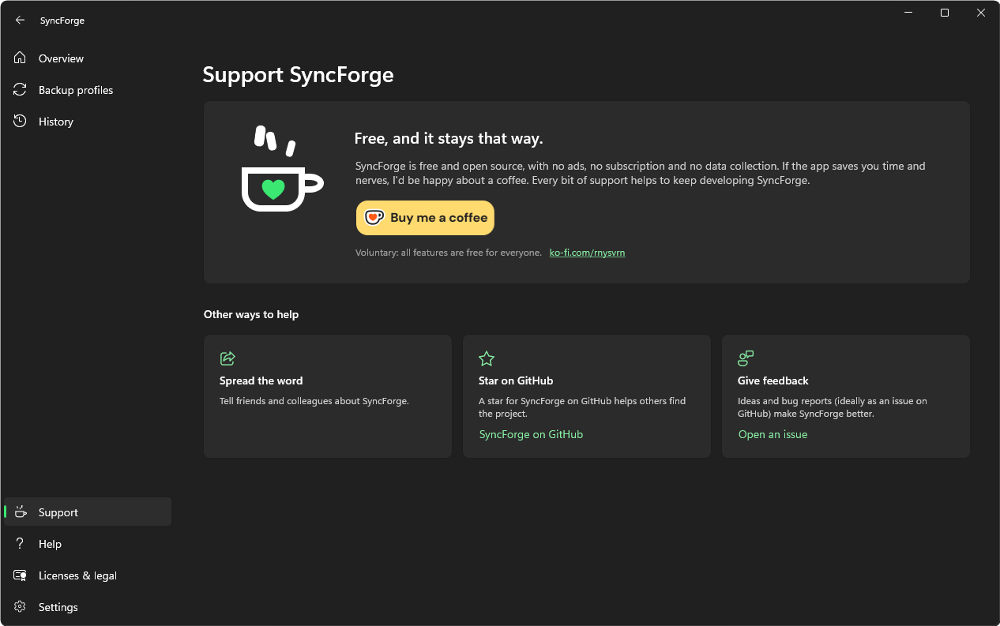 |
| 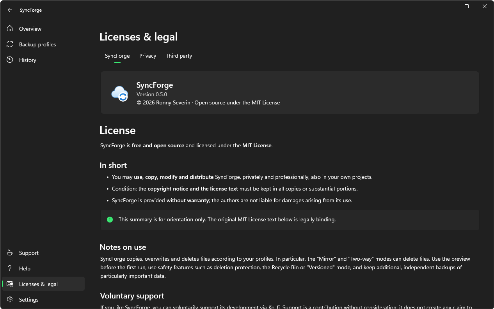 | |

</details>

## Installation
Unter [Releases](https://github.com/RNYSVRN/SyncForge/releases/latest) die neueste Version herunterladen:
- `SyncForge-x.y.z-x64-Setup.exe`: Installationsprogramm, ohne Administratorrechte.
- `SyncForge-x.y.z-x64.zip`: ohne Installation, entpacken und `SyncForge.exe` starten.

Das winget-Paket `RonnySeverin.SyncForge` wird gerade geprüft.

Voraussetzung: Windows 11 (x64). Die Dateien sind nicht signiert, Windows SmartScreen zeigt deshalb beim ersten Start
einen Hinweis: **Weitere Informationen** und dann **Trotzdem ausführen**. Die Prüfsummen stehen in jedem Release.

## Befehlszeile
Profile aus Skripten oder der Aufgabenplanung starten. Ist SyncForge schon geöffnet, übernimmt das offene Fenster den Lauf.
```powershell
SyncForge.exe --run "Dokumente"           # Profil synchronisieren (Name oder ID, mehrfach möglich)
SyncForge.exe --run-all                   # alle Profile synchronisieren
SyncForge.exe --list                      # Profile mit ihrer ID auflisten
SyncForge.exe --help
```
Exitcodes: 0 Erfolg, 1 Warnung, 2 Fehler, 3 abgebrochen, 4 Profil nicht gefunden, 5 ungültige Argumente, 6 läuft bereits.

## Datenschutz
SyncForge arbeitet vollständig lokal: keine Telemetrie, keine Werbung, kein Konto. Einzige Ausnahme ist die optionale,
standardmäßig ausgeschaltete Update-Prüfung, die einmal täglich bei GitHub nach einer neuen Version fragt.

## Unterstützen
SyncForge ist kostenlos und bleibt es. Wenn dir die App Zeit und Nerven spart, freue ich mich über einen Kaffee:
[ko-fi.com/rnysvrn](https://ko-fi.com/rnysvrn). Ein Stern auf GitHub und Rückmeldungen als
[Issue](https://github.com/RNYSVRN/SyncForge/issues) helfen ebenfalls.

---

# Entwicklung
Funktionsumfang und Etappenplan: siehe [SPEC.md](SPEC.md).

## Voraussetzungen
- Windows 11
- .NET 10 SDK (`winget install Microsoft.DotNet.SDK.10`)
- Optional: Visual Studio 2026 mit Workload „WinUI-Anwendungsentwicklung“ zum Debuggen

## Bauen & Starten
```powershell
dotnet build SyncForge.sln -c Debug -p:Platform=x64
.\src\SyncForge\bin\x64\Debug\net10.0-windows10.0.26100.0\SyncForge.exe
```

## Tests
```powershell
dotnet test --project tests\SyncForge.Core.Tests\SyncForge.Core.Tests.csproj
```
Der Lasttest mit 100.000 Dateien läuft nur auf Anforderung:
```powershell
dotnet test --project tests\SyncForge.Core.Tests\SyncForge.Core.Tests.csproj -- --filter-class "*LoadTests" --explicit only
```

## Veröffentlichen (GitHub Release, winget)
Voraussetzung: Inno Setup 6 (`winget install JRSoftware.InnoSetup`). Version in `src/SyncForge/SyncForge.csproj` (`<Version>`) erhöhen, dann:
```powershell
powershell -ExecutionPolicy Bypass -File tools\Build-Release.ps1   # Repository: RNYSVRN/SyncForge (siehe AppInfo.cs)
```
Ergebnis in `artifacts\release\`:
- `SyncForge-x.y.z-x64-Setup.exe`: Installationsprogramm, pro Benutzer ohne Administratorrechte nach
  `%LOCALAPPDATA%\Programs\SyncForge`. Beendet eine laufende SyncForge-Instanz vor Update und Deinstallation.
  Die Deinstallation entfernt Autostart-Eintrag und Benachrichtigungs-Registrierung und fragt, ob auch Einstellungen,
  Profile und Historie gelöscht werden sollen (still: nie).
- `SyncForge-x.y.z-x64.zip`: ohne Installation, entpacken und `SyncForge.exe` starten.
- `SHA256SUMS.txt`: Prüfsummen für die Release-Beschreibung.
- `winget\manifests\...`: winget-Manifest (Vorlagen in `installer\winget`), Prüfung mit `winget validate --manifest <Ordner>`.

Ablauf mit GitHub Actions (`.github/workflows/build.yml`):
- Jeder Push auf `main` und jeder Pull Request: Tests und Build.
- Tag `vx.y.z` pushen (muss zur `<Version>` in der Projektdatei passen):
  `git tag v0.5.0` und `git push origin v0.5.0`. Die Action baut Setup, ZIP und Prüfsummen, legt damit einen
  **Release-Entwurf** an und stellt das winget-Manifest als Artefakt bereit. Auf GitHub die Neuerungen eintragen
  und den Entwurf veröffentlichen.

Ohne Action (lokal):
1. GitHub Release mit dem Tag `vx.y.z` anlegen und Setup, ZIP und `SHA256SUMS.txt` anhängen.
2. winget: Den Ordner `artifacts\release\winget\manifests\r\RonnySeverin\SyncForge\x.y.z` per Pull Request in
   [microsoft/winget-pkgs](https://github.com/microsoft/winget-pkgs) unter demselben Pfad einreichen
   (alternativ mit dem Werkzeug `wingetcreate`). Danach: `winget install RonnySeverin.SyncForge`.

Die Dateien sind nicht signiert. Beim ersten Start aus dem Browser zeigt Windows SmartScreen deshalb einen Hinweis
(„Weitere Informationen › Trotzdem ausführen“). Ist die intelligente App-Steuerung aktiv, blockiert Windows
unsignierte Apps ganz.

Mitgeliefert wird nur, was SyncForge braucht: Die KI-, ML-, Such- und Widget-Teile des Windows App SDK sind in der
Projektdatei mit `ExcludeAssets="all"` ausgeschlossen (spart rund 60 MB). Die Ressourcendatei `SyncForge.pri`
kopiert ein eigener Build-Schritt mit, ohne sie startet die unpaketierte App nicht.

## MSIX-Paket
```powershell
powershell -File tools\Build-Msix.ps1                       # baut artifacts\msix\...\SyncForge_x.y.z.0_x64.msix
powershell -ExecutionPolicy Bypass -File tools\Install-Msix.ps1   # als Administrator: Testzertifikat, signieren, installieren
```
`Install-Msix.ps1` legt ein selbstsigniertes Zertifikat „CN=SyncForge Dev“ an und vertraut ihm für App-Pakete.
Deinstallieren: `Get-AppxPackage SyncForge | Remove-AppxPackage`. Die installierte App hat eigene Daten (paketierter
AppData-Bereich), getrennt vom unpaketierten Entwicklungs-Build.

## Hilfe, Rechtstexte und Lizenzen
- Hilfe: `src/SyncForge/Assets/Help/Deutsch|English/*.md`: ein Thema pro Datei, Reihenfolge nach Dateiname,
  erste Zeile `<!-- glyph:E7C1 -->` = Symbol (Segoe Fluent Icons). Unterstützt: `#`/`##`/`###`, Absätze, `-`/`1.` Listen,
  `> Hinweis`, `**fett**`, `` `Code` ``.
- Lizenz-Seite und Datenschutz: `src/SyncForge/Assets/Legal/Deutsch|English/license.md` bzw. `privacy.md`
- Drittanbieter-Lizenzen: nach jedem Paket-Update `powershell -File tools\Collect-Licenses.ps1` ausführen
  (liest die verwendeten Paketversionen aus dem Build und übernimmt die Lizenztexte aus den NuGet-Paketen).

## Screenshots
Die Bilder in `docs/screenshots/light|dark/` zeigen Demo-Daten (Fenster 1280 × 800, englische Oberfläche). Wenn sich
Seiten ändern, beide Designs neu aufnehmen, damit die README einheitlich bleibt.

## Sync-Modi
| Modus | Verhalten |
|---|---|
| Spiegeln | Ziel = exakte Kopie der Quelle (inkl. Löschungen; optional Papierkorb) |
| Versioniert | wie Spiegeln, überschriebene/gelöschte Dateien landen in `Ziel\.syncforge_versions\` (Seite „Versionen“ zum Wiederherstellen) |
| Zwei-Wege | Änderungen und Löschungen in beide Richtungen; Stand nach dem letzten Lauf in `%LOCALAPPDATA%\SyncForge\state\`; Konflikte: neuere gewinnt / Quelle gewinnt / beide behalten / nur melden (später pro Datei entscheiden) |

## Projektstruktur
```
src/SyncForge.Core/      Sync-Logik ohne UI (testbar)
  Models/                Profil, Quellen, Ziele, Filter- und Automatik-Einstellungen
  Filtering/PathFilter   Ein-/Ausschlussmuster (*.tmp, ordner\, a\**\b)
  Engine/SyncPlanner     Analyse: Quelle vs. Ziel -> Plan (verändert nichts)
  Engine/SyncExecutor    Ausführung: Temp-Datei + Ersetzen, parallel, Abbruch, Papierkorb, Bandbreitenlimit
  Engine/ProfileRunner   Mehrere Quellen und Ziele, Erreichbarkeit, Löschschutz
  Engine/TwoWayPlanner   Zwei-Wege-Abgleich mit gemeinsamem Stand und Konfliktregeln
  Engine/VolumeResolver  USB-/lokale Ziele über die Volume-ID (auch unter anderem Laufwerksbuchstaben)
  Engine/ShadowCopySession  Schattenkopie für gesperrte Dateien (nur als Administrator)
  Engine/IoPriority      Niedrige E/A-Priorität pro Datei-Handle
  Network/               Netzwerkfreigaben und gespeicherte Anmeldedaten
  Cli/CommandLine        Auswertung von --run, --run-all, --list, --help
  Storage/ProfileStore   profiles.json
  History/HistoryStore   history.db (SQLite): Läufe, Ergebnisse je Ziel, Datei-Protokoll, Statistiken
  History/CsvWriter      CSV für Excel (Trennzeichen aus den Regionseinstellungen, formelsicher)
  Scheduling/            Zeitplan-Berechnung (Intervall, täglich, Wochentage, Nachholen)
  Versioning/            Versionsordner: verschieben, auflisten, wiederherstellen, aufräumen
  Updates/               Optionale Update-Prüfung (GitHub Releases)
tests/SyncForge.Core.Tests/  xUnit-Tests gegen echte Temp-Ordner
src/SyncForge/
  App.xaml(.cs)          Start, DI-Container, Sprache, Fehlerprotokoll
  MainWindow.xaml(.cs)   Titelleiste, Mica, NavigationView, Fenstergröße, Tastenkürzel
  Views/                 Übersicht, Profile, Assistent, Profil-Editor, Vorschau/Lauf, Versionen, Konflikte,
                         Historie, Laufdetails, Einstellungen, Hilfe, Unterstützen, Rechtliches
  Controls/              DailyBarChart, MarkdownView, CoffeeSteam
  ViewModels/            MVVM (CommunityToolkit.Mvvm)
  Program.cs             Einstiegspunkt mit Einzelinstanz-Weiterleitung und Befehlszeile
  Services/              Einstellungen, Design, Lokalisierung, SyncCoordinator (alle Läufe),
                         AutomationService (Zeitplan, Überwachung, Laufwerke), TrayIcon (Win32),
                         NotificationService, StartupService, UpdateService, CommandLineRunner,
                         ProfileValidation, PathHints, HistoryExport
  Strings/<Sprache>/     Resources.resw (generiert, nicht von Hand bearbeiten)
  Assets/                App-Icon, Hilfe, Rechtstexte, Lizenzen
installer/               Inno-Setup-Skript und winget-Vorlagen
docs/screenshots/        Screenshots für die README (hell und dunkel)
tools/
  strings.csv            Alle UI-Texte (Deutsch/Englisch) an einer Stelle
  Generate-Strings.ps1   strings.csv → .resw
  Generate-Icon.ps1      zeichnet AppIcon.png und SyncForge.ico
  Build-Release.ps1      Setup, ZIP, Prüfsummen, winget-Manifest
```

## Texte übersetzen / ergänzen
1. Zeile in `tools/strings.csv` ergänzen (`Schlüssel;Deutsch;Englisch`, keine Semikolons in den Texten). Für
   XAML-Elemente lautet der Schlüssel `<x:Uid>.<Eigenschaft>`, z. B. `Settings_Theme.Header`.
2. `powershell -File tools/Generate-Strings.ps1` ausführen.
3. Im Code: `Localization.Get("Schlüssel")`.

## Daten
Einstellungen und Protokolle liegen unter `%LOCALAPPDATA%\SyncForge\`
(`settings.json`, `profiles.json`, `history.db`, `state\`, `crash.log` bei Fehlern).
