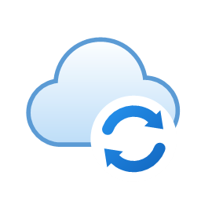
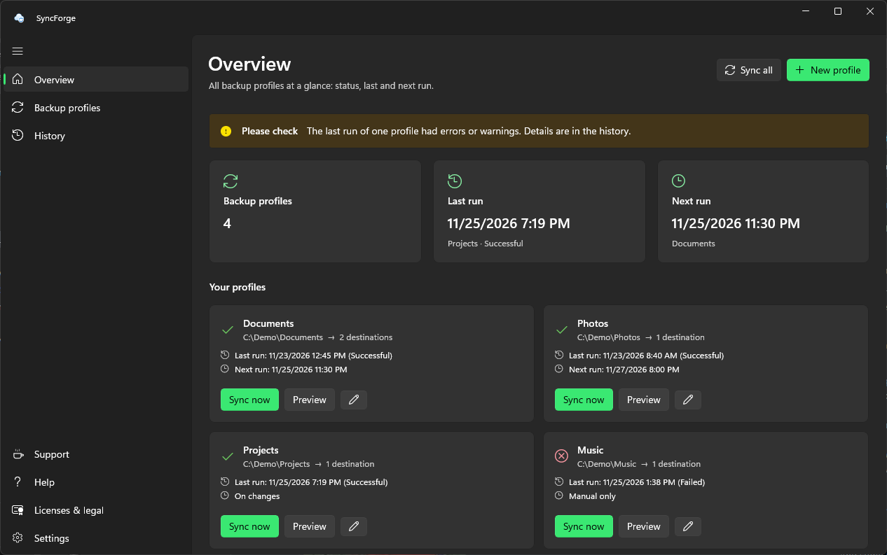
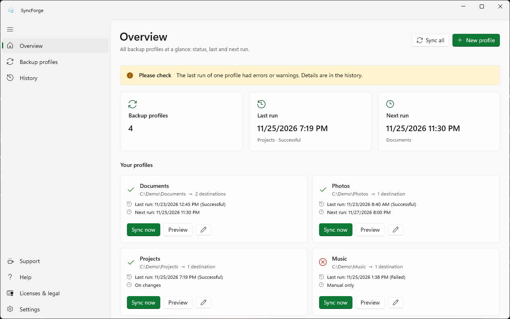
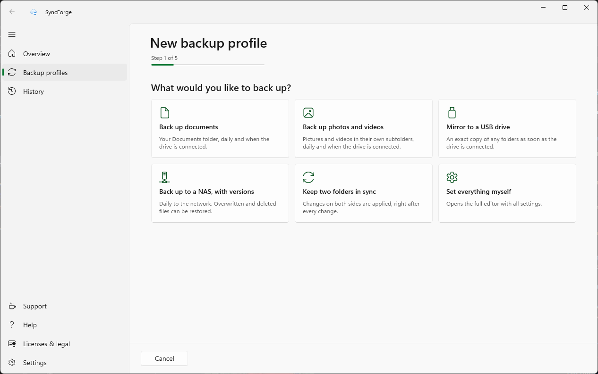
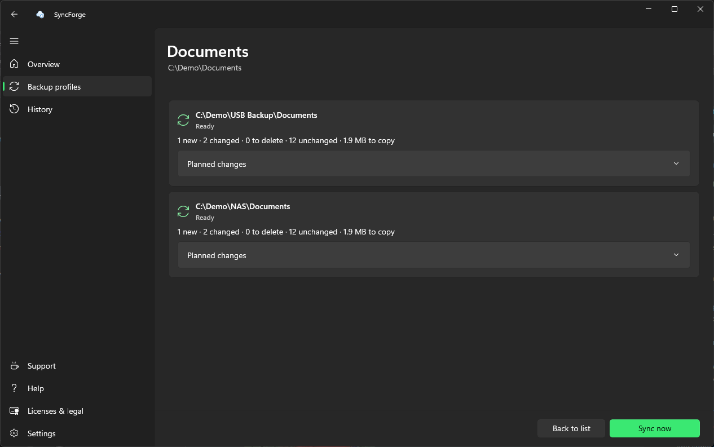
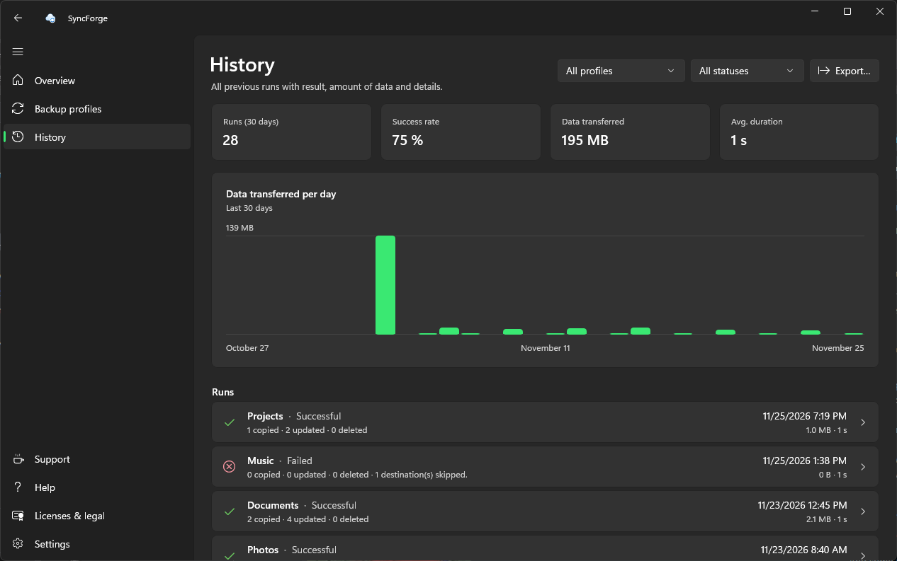
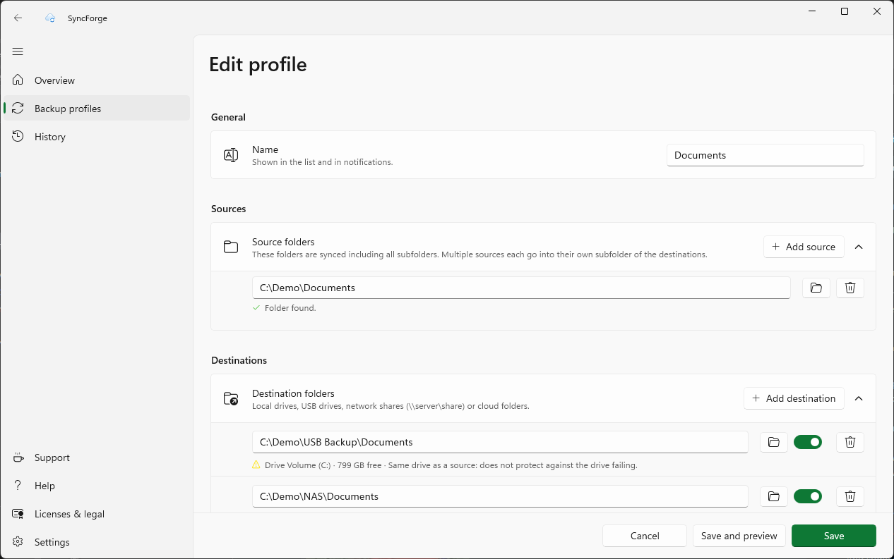

<p align="center">
  
</p>

<h1 align="center">SyncForge</h1>

<p align="center">
  Back up and sync folders on Windows 11: to USB drives, network shares and cloud folders.<br>
  <b>English</b> · <a href="README.de.md">Deutsch</a>
</p>

<p align="center">
  <a href="https://github.com/RNYSVRN/SyncForge/releases/latest"></a>
  
  <a href="LICENSE"></a>
</p>

<p align="center">
  
  
</p>

Backups only help if they actually happen. **SyncForge** copies your folders to one or more destinations, on a schedule, when something changes or as soon as the USB drive is plugged in. Before every run you see exactly what will be copied, changed and deleted, and nothing is ever overwritten silently. Mirror, versioned backup or two-way sync, all in a native Windows 11 app.

## Download

**[⬇ Download the latest installer](https://github.com/RNYSVRN/SyncForge/releases/latest)** (`SyncForge-Setup-x.y.z.exe`)

No .NET installation needed, everything is included. Requires Windows 11, 64-bit. By default it installs for your user account only (no admin prompt); you can choose to install for all users.

> [!NOTE]
> **Windows may warn you on first start.** SyncForge is free and therefore **not code-signed** (a signature costs money every month).
> - *“Windows protected your PC”* (SmartScreen): click **More info** → **Run anyway**.
> - *“An Application Control policy has blocked this file”* (Smart App Control): Smart App Control only allows signed apps. SyncForge then only runs with Smart App Control turned off (*Windows Security → App & browser control*). Note: once turned off, it can only be turned back on by resetting Windows. Decide for yourself.
>
> The complete source code is in this repository, so you can review it or build it yourself.

## Features

- **Set up in a minute**
  - Wizard with templates: back up documents, photos and videos, mirror to a USB drive, NAS with versions, two folders in sync
  - Profiles with several sources and several destinations, one after another or at the same time
- **Three modes**
  - *Mirror*: the destination is an exact copy of the source (deletions optionally to the Recycle Bin)
  - *Versioned*: like mirror, but overwritten and deleted files are kept and can be restored
  - *Two-way*: changes and deletions in both directions; conflicts by rule (newer wins, source wins, keep both) or decided per file
- **Runs on its own**: schedules (interval, daily, chosen weekdays) with catch-up of missed runs, real-time watching, at startup and as soon as the destination drive is connected, even under another drive letter
- **Safe by design**
  - Preview before every run, per destination
  - Deletion protection, Recycle Bin, optional checksum verification, never half-copied files (temp file, then replace)
  - Locked files (e.g. an open Outlook PST) are read via a volume shadow copy
- **Considerate**: low I/O priority and bandwidth limit, pauses on battery and on metered connections; online-only cloud files (OneDrive and co.) are skipped instead of downloaded
- **Network shares** with stored credentials
- **Transparent**: history with statistics, a chart of the last 30 days and details for every file; CSV export for Excel
- **Notification area**, notifications and start with Windows
- **Command line** for scripts and the Task Scheduler
- **Windows 11 Fluent design**: light/dark mode, your accent color, Mica, collapsible navigation; fully usable with keyboard and screen reader
- **English and German**, with built-in help
- **Private**: no telemetry, no ads, no account

<p align="center">
  
  
</p>
<p align="center">
  
  
</p>

## Command line

```
SyncForge --run "Documents"     sync a profile (name or ID, can be repeated)
SyncForge --run-all             sync all profiles
SyncForge --list                list profiles with their ID
SyncForge --help
```

If SyncForge is already running, the run is handed over to it. Exit codes: 0 success, 1 warning, 2 error, 3 cancelled, 4 profile not found, 5 invalid arguments, 6 already running.

## Good to know

- **Where the data lives**: `%LocalAppData%\SyncForge` holds the settings, profiles (`profiles.json`), history (`history.db`) and the state of two-way profiles. Earlier versions of files are kept in the destination under `.syncforge_versions`.
- **Uninstalling** removes the startup entry and the notification registration and asks whether settings, profiles and history should be deleted too. Your backed-up files in the destinations are always kept.
- **Updates**: the optional update check (off by default) asks GitHub once a day for a new version. Nothing is installed automatically: run the new installer, profiles and settings are kept.
- **Locked files** via volume shadow copy need SyncForge to run as administrator; everything else runs without.

## Build from source

Requirements: [.NET 10 SDK](https://dotnet.microsoft.com/download), optionally [Inno Setup 6](https://jrsoftware.org/isdl.php) for the installer.

```powershell
dotnet build SyncForge.sln -c Debug -p:Platform=x64                            # app
dotnet test --project tests\SyncForge.Core.Tests\SyncForge.Core.Tests.csproj   # tests
powershell -ExecutionPolicy Bypass -File installer\build.ps1                   # self-contained build + installer in dist\
```

All UI texts are in `tools/strings.csv` (German and English); `tools/Generate-Strings.ps1` turns them into the `.resw` files. The help topics are Markdown files in `src/SyncForge/Assets/Help`.

## Support

SyncForge is free and stays that way. If it saves you time and nerves, I'm happy about a coffee:

<a href="https://ko-fi.com/RNYSVRN"></a>

Ideas and bug reports are welcome as [issues](https://github.com/RNYSVRN/SyncForge/issues).

## Credits

Built with the [Windows App SDK](https://github.com/microsoft/WindowsAppSDK) (WinUI 3), the [Windows Community Toolkit](https://github.com/CommunityToolkit/Windows), the [.NET Community Toolkit](https://github.com/CommunityToolkit/dotnet) and [SQLite](https://sqlite.org) via Microsoft.Data.Sqlite. The license texts are included in the app (*Licenses & legal*).

## License

[MIT](LICENSE) © 2026 Ronny Severin.
