<div align="center">


# SyncForge

**Folder sync and backup for Windows 11. Free, open source, no account.**

[](https://github.com/RNYSVRN/SyncForge/releases/latest)
[](https://github.com/RNYSVRN/SyncForge/actions/workflows/build.yml)
[](LICENSE)


[Download](https://github.com/RNYSVRN/SyncForge/releases/latest) · [Features](#features) · [Screenshots](#screenshots) · [Command line](#command-line) · [Support](#support)

**English** · [Deutsch](README.de.md)

</div>

<picture>
  <source media="(prefers-color-scheme: dark)" srcset="docs/screenshots/dark/01-overview.png">
  
</picture>

SyncForge keeps your folders safe on local drives, USB drives, network shares (NAS) and cloud folders.
A native WinUI 3 app built with .NET 10: fast, light and at home in Windows 11, in light and dark mode,
in English and German.

## Features

**Set up in a minute**
- Wizard with templates: back up documents, photos and videos, mirror to a USB drive, NAS with versions, two folders in sync
- Backup profiles with several sources and several destinations, one after another or at the same time
- Three modes: **mirror**, **versioned** (overwritten and deleted files can be restored) and **two-way** with conflict rules

**Runs on its own**
- Schedules (interval, daily, on chosen weekdays) and catch-up of missed runs
- Real-time watching, at SyncForge start, and as soon as the destination drive is connected (even under another drive letter)
- Command line for scripts and the Task Scheduler, with meaningful exit codes

**Safe by design**
- Preview before every run: see exactly what will be copied, changed and deleted
- Deletion protection, Recycle Bin, optional checksum verification, never half-copied files (temp file, then replace)
- Two-way conflicts are decided per file, never silently overwritten
- Locked files (for example an open Outlook PST) can be read via a volume shadow copy

**Considerate**
- Low I/O priority and a bandwidth limit, globally or per profile
- Pauses on battery power and on metered connections
- Online-only cloud files (OneDrive and co.) are skipped instead of downloaded

**Transparent**
- History with statistics, a chart of the last 30 days and details for every single file
- Export runs and file lists as CSV, ready for Excel
- Notifications, notification area icon, start with Windows

**At home in Windows**
- Fluent design with Mica, light, dark and high contrast
- Fully usable with keyboard and screen reader
- No telemetry, no ads, no account

## Screenshots

Screenshots follow your GitHub theme. Both complete sets (light and dark) are in the galleries at the end of this section.

### Wizard
Pick a template, check the suggested folders, choose a destination. Done.

<picture>
  <source media="(prefers-color-scheme: dark)" srcset="docs/screenshots/dark/04-wizard.png">
  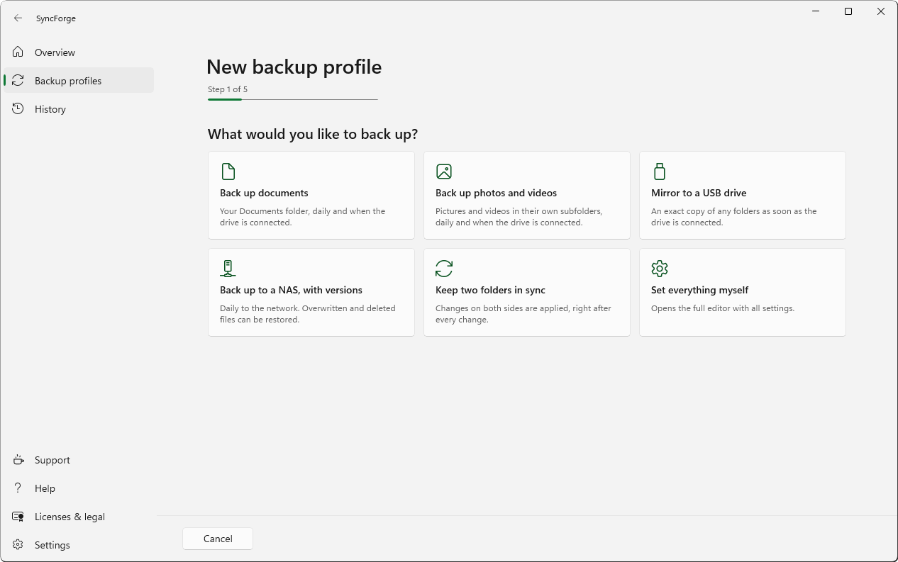
</picture>

### Preview
Before anything happens you see every planned change per destination.

<picture>
  <source media="(prefers-color-scheme: dark)" srcset="docs/screenshots/dark/05-preview.png">
  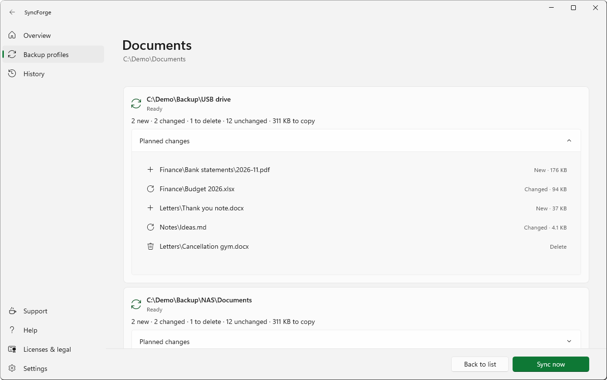
</picture>

### History
Every run with statistics, a daily chart, filters and CSV export.

<picture>
  <source media="(prefers-color-scheme: dark)" srcset="docs/screenshots/dark/07-history.png">
  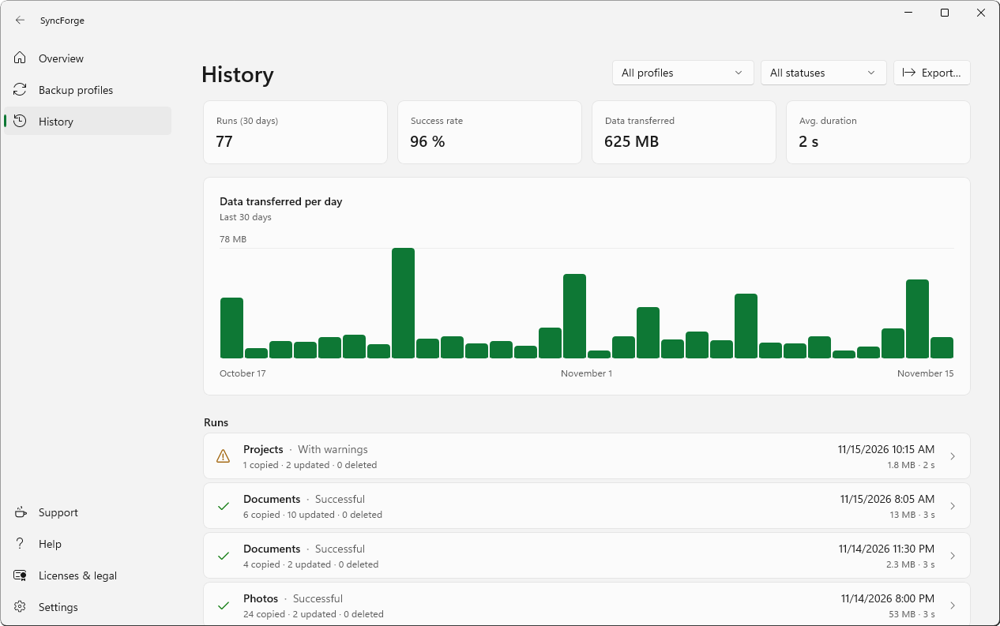
</picture>

### Profile editor
All settings of a profile on one page, with instant hints for paths and drives.

<picture>
  <source media="(prefers-color-scheme: dark)" srcset="docs/screenshots/dark/03-editor.png">
  
</picture>

<details>
<summary><b>More pages</b>: profiles, versions, run details, conflicts, settings, help, support, licenses</summary>

#### Backup profiles
<picture>
  <source media="(prefers-color-scheme: dark)" srcset="docs/screenshots/dark/02-profiles.png">
  
</picture>

#### Restore versions
<picture>
  <source media="(prefers-color-scheme: dark)" srcset="docs/screenshots/dark/06-versions.png">
  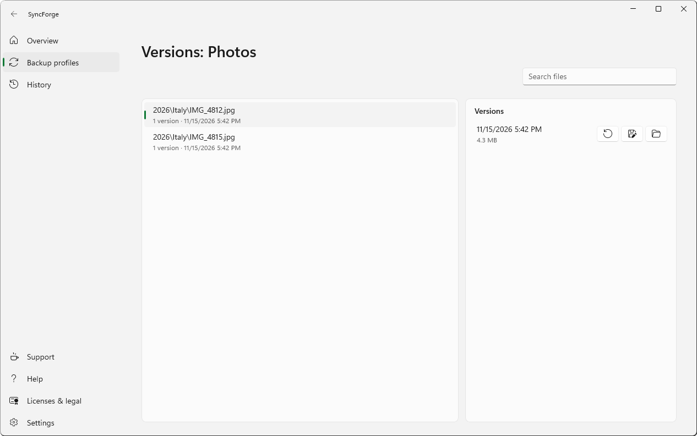
</picture>

#### Run details
<picture>
  <source media="(prefers-color-scheme: dark)" srcset="docs/screenshots/dark/08-run-details.png">
  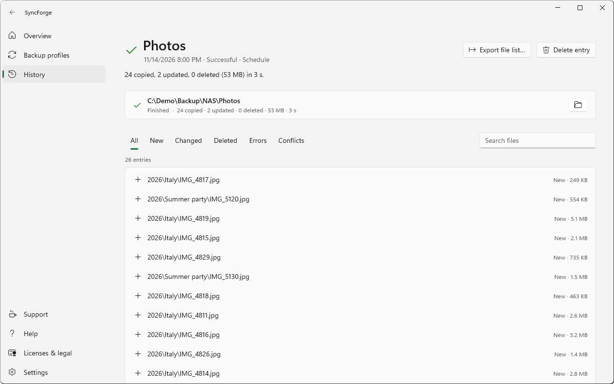
</picture>

#### Resolve conflicts
<picture>
  <source media="(prefers-color-scheme: dark)" srcset="docs/screenshots/dark/09-conflicts.png">
  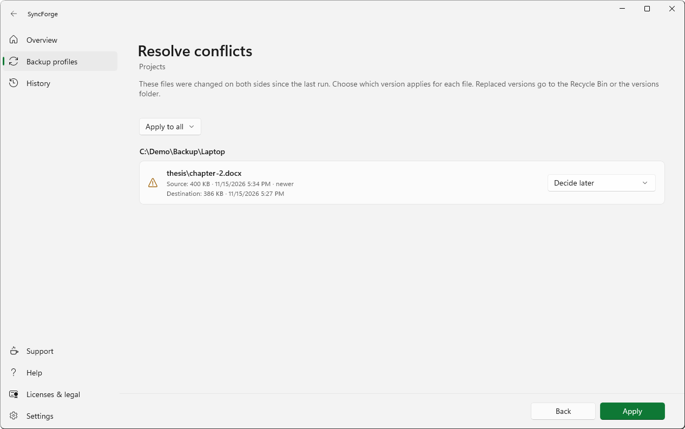
</picture>

#### Settings
<picture>
  <source media="(prefers-color-scheme: dark)" srcset="docs/screenshots/dark/10-settings.png">
  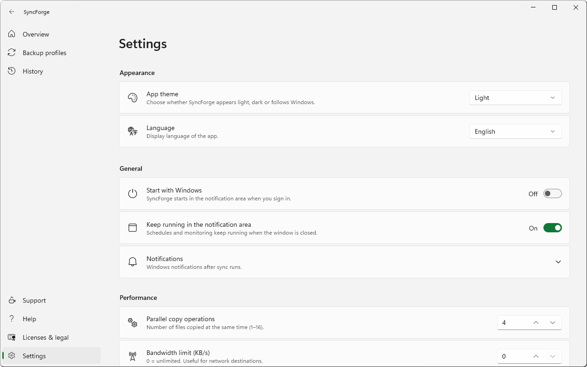
</picture>

#### Built-in help
<picture>
  <source media="(prefers-color-scheme: dark)" srcset="docs/screenshots/dark/11-help.png">
  
</picture>

#### Support
<picture>
  <source media="(prefers-color-scheme: dark)" srcset="docs/screenshots/dark/12-support.png">
  
</picture>

#### Licenses & legal
<picture>
  <source media="(prefers-color-scheme: dark)" srcset="docs/screenshots/dark/13-licenses.png">
  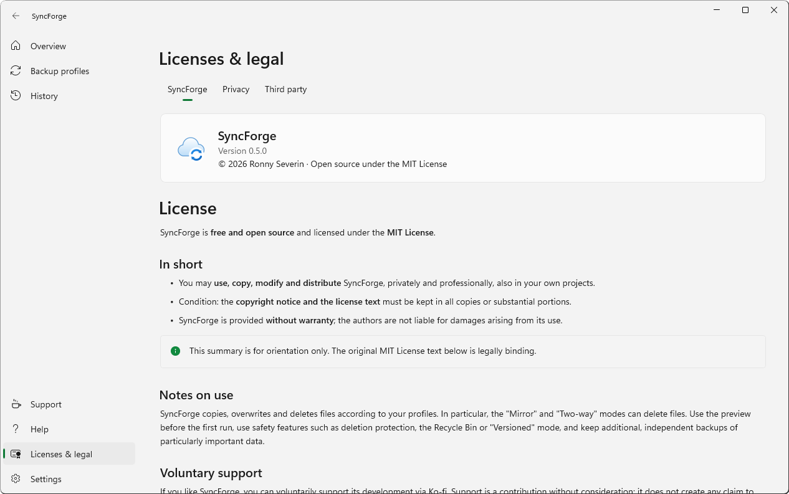
</picture>

</details>

<details>
<summary><b>Gallery: light mode</b> (all pages)</summary>

| | |
|---|---|
|  |  |
|  |  |
|  |  |
|  |  |
|  |  |
|  |  |
|  | |

</details>

<details>
<summary><b>Gallery: dark mode</b> (all pages)</summary>

| | |
|---|---|
|  |  |
|  | 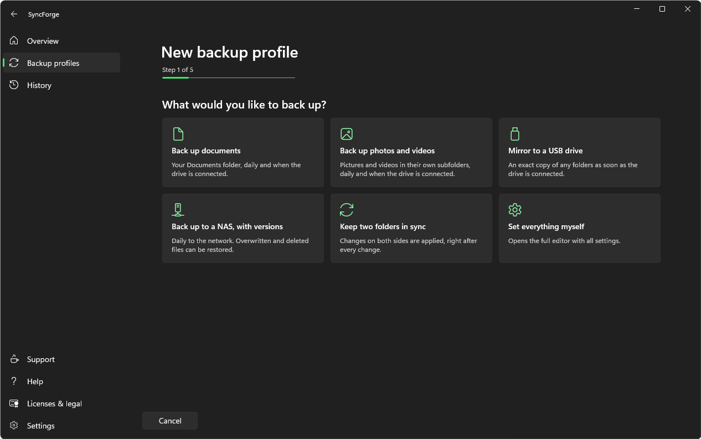 |
|  |  |
| 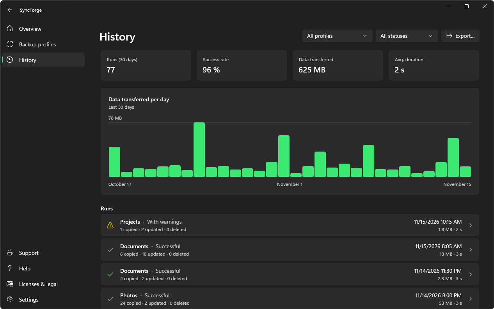 |  |
| 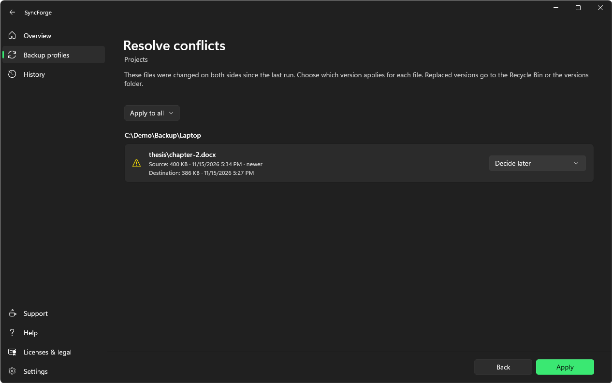 | 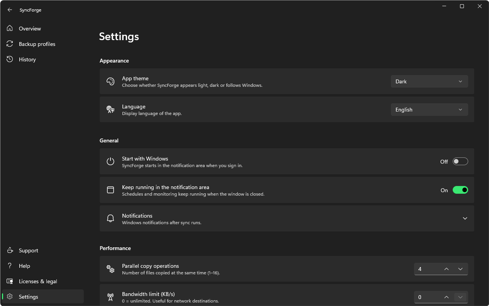 |
|  |  |
|  | |

</details>

## Installation
Download the latest version from [Releases](https://github.com/RNYSVRN/SyncForge/releases/latest):
- `SyncForge-x.y.z-x64-Setup.exe`: installer, no administrator rights needed.
- `SyncForge-x.y.z-x64.zip`: no installation, unzip and run `SyncForge.exe`.

The winget package `RonnySeverin.SyncForge` is currently under review.

Requires Windows 11 (x64). The files are not code-signed, so Windows SmartScreen shows a notice on first launch:
choose **More info** and then **Run anyway**. Every release lists the SHA-256 checksums.

## Command line
Run profiles from scripts or the Task Scheduler. If SyncForge is already open, the run is handed over to it.
```powershell
SyncForge.exe --run "Documents"           # sync a profile (name or ID, can be repeated)
SyncForge.exe --run-all                   # sync all profiles
SyncForge.exe --list                      # list profiles with their ID
SyncForge.exe --help
```
Exit codes: 0 success, 1 warning, 2 error, 3 cancelled, 4 profile not found, 5 invalid arguments, 6 already running.

## Privacy
SyncForge works entirely locally: no telemetry, no ads, no account. The only exception is the optional update check,
which is off by default and asks GitHub once a day whether a new version exists.

## Support
SyncForge is free and will stay that way. If it saves you time and nerves, I'd be happy about a coffee:
[ko-fi.com/rnysvrn](https://ko-fi.com/rnysvrn). A star on GitHub and feedback as an
[issue](https://github.com/RNYSVRN/SyncForge/issues) help as well.

---

# Development
Feature scope and stage plan (German): see [SPEC.md](SPEC.md).

## Requirements
- Windows 11
- .NET 10 SDK (`winget install Microsoft.DotNet.SDK.10`)
- Optional: Visual Studio 2026 with the "WinUI application development" workload for debugging

## Build & run
```powershell
dotnet build SyncForge.sln -c Debug -p:Platform=x64
.\src\SyncForge\bin\x64\Debug\net10.0-windows10.0.26100.0\SyncForge.exe
```

## Tests
```powershell
dotnet test --project tests\SyncForge.Core.Tests\SyncForge.Core.Tests.csproj
```
The load test with 100,000 files runs only on demand:
```powershell
dotnet test --project tests\SyncForge.Core.Tests\SyncForge.Core.Tests.csproj -- --filter-class "*LoadTests" --explicit only
```

## Releases (GitHub, winget)
GitHub Actions (`.github/workflows/build.yml`):
- Every push to `main` and every pull request: tests and build.
- Pushing a tag `vX.Y.Z` (must match `<Version>` in `src/SyncForge/SyncForge.csproj`), e.g.
  `git tag v0.5.0` and `git push origin v0.5.0`: the action builds the installer, ZIP and checksums, creates a
  **release draft** and uploads the winget manifest as an artifact. Add the release notes on GitHub and publish the draft.

Locally (requires Inno Setup 6: `winget install JRSoftware.InnoSetup`):
```powershell
powershell -ExecutionPolicy Bypass -File tools\Build-Release.ps1
```
Output in `artifacts\release\`:
- `SyncForge-x.y.z-x64-Setup.exe`: per-user installer (no admin rights) into `%LOCALAPPDATA%\Programs\SyncForge`.
  Stops a running SyncForge before updating or uninstalling. Uninstalling removes the startup entry and the
  notification registration and asks whether settings, profiles and history should be deleted too (silent: never).
- `SyncForge-x.y.z-x64.zip`: portable, no installation.
- `SHA256SUMS.txt`: checksums for the release notes.
- `winget\manifests\...`: winget manifest (templates in `installer\winget`), check with `winget validate --manifest <folder>`.

winget: submit the folder `winget\manifests\r\RonnySeverin\SyncForge\x.y.z` as a pull request to
[microsoft/winget-pkgs](https://github.com/microsoft/winget-pkgs) under the same path (or use `wingetcreate`).
Afterwards: `winget install RonnySeverin.SyncForge`.

Only what SyncForge needs is shipped: the AI, ML, search and widget parts of the Windows App SDK are excluded in the
project file with `ExcludeAssets="all"` (saves about 60 MB). A custom build step copies the resource file
`SyncForge.pri`, without it the unpackaged app does not start.

## MSIX package
```powershell
powershell -File tools\Build-Msix.ps1                             # builds artifacts\msix\...\SyncForge_x.y.z.0_x64.msix
powershell -ExecutionPolicy Bypass -File tools\Install-Msix.ps1   # as administrator: test certificate, sign, install
```
`Install-Msix.ps1` creates a self-signed certificate "CN=SyncForge Dev" and trusts it for app packages.
Uninstall: `Get-AppxPackage SyncForge | Remove-AppxPackage`. The installed app has its own data (packaged AppData
area), separate from the unpackaged development build.

## Help, legal texts and licenses
- Help: `src/SyncForge/Assets/Help/Deutsch|English/*.md`, one topic per file, ordered by file name,
  first line `<!-- glyph:E7C1 -->` = icon (Segoe Fluent Icons). Supported: `#`/`##`/`###`, paragraphs, `-`/`1.` lists,
  `> note`, `**bold**`, `` `code` ``.
- License page and privacy statement: `src/SyncForge/Assets/Legal/Deutsch|English/license.md` and `privacy.md`.
- Third-party licenses: run `powershell -File tools\Collect-Licenses.ps1` after every package update
  (reads the package versions used by the build and takes the license texts from the NuGet packages).

## Screenshots
The images in `docs/screenshots/light|dark/` (English) and `docs/screenshots/de/light|dark/` (German, used by
README.de.md) show demo data (window 1280 × 800). When pages change,
take them again in both themes so the README stays consistent.

## Sync modes
| Mode | Behavior |
|---|---|
| Mirror | Destination = exact copy of the source (including deletions, optionally to the Recycle Bin) |
| Versioned | Like mirror, overwritten or deleted files go to `Destination\.syncforge_versions\` ("Versions" page to restore) |
| Two-way | Changes and deletions in both directions, state after the last run in `%LOCALAPPDATA%\SyncForge\state\`. Conflicts: newer wins / source wins / keep both / just report (decide per file later) |

## Project structure
```
src/SyncForge.Core/      Sync logic without UI (testable)
  Models/                Profile, sources, destinations, filter and automation settings
  Filtering/PathFilter   Include/exclude patterns (*.tmp, folder\, a\**\b)
  Engine/SyncPlanner     Analysis: source vs. destination -> plan (changes nothing)
  Engine/SyncExecutor    Execution: temp file + replace, parallel, cancel, Recycle Bin, bandwidth limit
  Engine/ProfileRunner   Multiple sources and destinations, reachability, deletion protection
  Engine/TwoWayPlanner   Two-way sync with shared state and conflict rules
  Engine/VolumeResolver  USB/local destinations via volume ID (also under another drive letter)
  Engine/ShadowCopySession  Volume shadow copy for locked files (administrator only)
  Engine/IoPriority      Low I/O priority per file handle
  Network/               Network shares and stored credentials
  Cli/CommandLine        Parsing of --run, --run-all, --list, --help
  Storage/ProfileStore   profiles.json
  History/HistoryStore   history.db (SQLite): runs, results per destination, file log, statistics
  History/CsvWriter      CSV for Excel (separator from the region settings, formula-safe)
  Scheduling/            Schedule calculation (interval, daily, weekdays, catch-up)
  Versioning/            Versions folder: move, list, restore, clean up
  Updates/               Optional update check (GitHub Releases)
tests/SyncForge.Core.Tests/  xUnit tests against real temp folders
src/SyncForge/
  App.xaml(.cs)          Startup, DI container, language, error log
  MainWindow.xaml(.cs)   Title bar, Mica, NavigationView, window size, keyboard shortcuts
  Views/                 Overview, profiles, wizard, profile editor, preview/run, versions, conflicts,
                         history, run details, settings, help, support, legal
  Controls/              DailyBarChart, MarkdownView, CoffeeSteam
  ViewModels/            MVVM (CommunityToolkit.Mvvm)
  Program.cs             Entry point with single-instance redirection and command line
  Services/              Settings, theme, localization, SyncCoordinator (all runs),
                         AutomationService (schedules, watching, drives), TrayIcon (Win32),
                         NotificationService, StartupService, UpdateService, CommandLineRunner,
                         ProfileValidation, PathHints, HistoryExport
  Strings/<language>/    Resources.resw (generated, do not edit by hand)
  Assets/                App icon, help, legal texts, licenses
installer/               Inno Setup script and winget templates
docs/screenshots/        README screenshots (English and German, light and dark)
tools/
  strings.csv            All UI texts (German/English) in one place
  Generate-Strings.ps1   strings.csv -> .resw
  Generate-Icon.ps1      draws AppIcon.png and SyncForge.ico
  Build-Release.ps1      installer, ZIP, checksums, winget manifest
```

## Translating / adding texts
1. Add a line to `tools/strings.csv` (`Key;German;English`, no semicolons inside the texts). For XAML elements the key
   is `<x:Uid>.<Property>`, e.g. `Settings_Theme.Header`.
2. Run `powershell -File tools/Generate-Strings.ps1`.
3. In code: `Localization.Get("Key")`.

## Data
Settings and logs are stored in `%LOCALAPPDATA%\SyncForge\`
(`settings.json`, `profiles.json`, `history.db`, `state\`, `crash.log` after errors).
